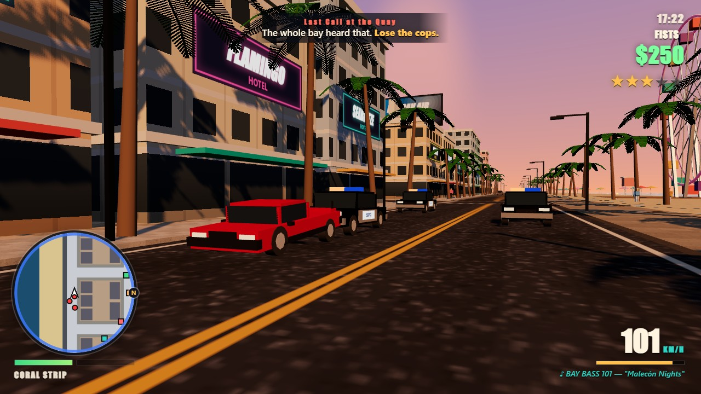

# HARBOR HEAT

[](https://make.fun/bounty/gta6-01?utm_source=github&utm_medium=readme&utm_campaign=gta6-01)
[](https://make.fun/bounty/gta6-01/leaderboard?utm_source=github&utm_medium=readme&utm_campaign=gta6-01)
[](https://make.fun/bounty/gta6-01?utm_source=github&utm_medium=readme&utm_campaign=gta6-01)

An original open-world crime game for the desktop browser, built with three.js. Everything — the
city, people, cars, textures, sound effects and music — is generated in code at load time; the game
makes no network requests.



## The story

Nico Reyes comes home to **Solara Bay** after six years away and finds his father's boat yard swallowed
by **Victor Kane**'s Kane Marine. Mari Vega, who runs the Tidewater Club on the Coral Strip, offers a
way back in: steal cars for Sal's body shop, run timed deliveries, lean on Tommy Brine, raid the Gulls'
container yard for Kane's ledger, hijack an armoured van with every cop in the bay behind you, and
finally take the fight to Kane's yacht on the quay. Seven missions, told through subtitled dialogue.

## What's in it

- **A city to explore** — five districts (Palm Heights, Downtown Solara, Vista Midtown, the Coral
  Strip with its neon hotels and Sunset Beach, the Old Port with cranes and container stacks), a pier
  ferris wheel, a lighthouse, a full day/night cycle with lit windows, street lamps and neon.
- **On foot and by car** — third-person controller with sprint, jump and an orbit camera; arcade car
  physics with handbrake drifts, damage, smoke, fire and explosions; seven vehicle types.
- **Traffic and pedestrians** — lane-following drivers that turn at junctions, brake and honk;
  pedestrians who cross streets, flee gunfire, cower, fight back and drop cash.
- **Carjacking** — pull any driver out of their car with `F`.
- **Wanted level and police** — witnesses and 911 calls raise heat to five stars; cruisers route
  across the road graph, ram you and unload armed officers who try to bust you; a helicopter with a
  searchlight joins at four stars. Break line of sight to cool off, or respray at Sal's.
- **Combat** — fists, pistol, SMG and shotgun with ammo, reloads, tracers, muzzle flashes, hit
  markers and headshots; enemy AI that closes in, strafes and reloads.
- **HUD** — rotating minimap with blips, full-screen map, health/armour, wanted stars, cash, clock,
  weapon and ammo, speedometer, radio station, mission objective, timers and subtitles.
- **Menus and saves** — title screen, pause with stats, controls and settings, three save slots plus
  autosave after each mission (safehouse `E` to save), gun shop, 12 hidden Sun Tokens.
- **Audio** — WebAudio-synthesised gunshots, engines, tyres, sirens, surf and city ambience, and two
  original radio stations plus a chase score from a step sequencer.

## Controls

| Key | Action |
| --- | --- |
| W A S D | Move / drive |
| Mouse | Look / aim |
| Shift | Sprint |
| Space | Jump · handbrake |
| Left click | Punch / shoot |
| Right click | Aim |
| 1–4 · Q · wheel | Switch weapon |
| R | Reload · next radio station |
| F | Enter / exit / steal a car |
| E | Use (shop, save, respray) |
| H / G | Horn / siren in a cruiser |
| M | Map |
| Esc / P | Pause |

## Run it

```bash
node serve.ts
```

Then open http://localhost:8080 in desktop Chrome and click to start. Node 22+ is the only requirement.

The screenshots are captured from the game itself: `?shot=chase|mission|combat|title` stages a
scene with the real systems, and `node tools/shoot.mjs` renders the list in `shots.json` with headless
Chrome.

## Layout

```
game/index.html          page, HUD and menu markup
game/style.css           HUD and menu styling
game/src/main.js         renderer, world build, fixed-order update loop
game/src/core/           config, input, RNG, shared game state and events
game/src/world/          city layout, buildings shader, terrain, sky, props, collision, textures
game/src/entities/       procedural models, characters, vehicles
game/src/systems/        player control, traffic, pedestrians, police, combat, missions, saves, effects
game/src/audio/          synthesised sound effects, music sequencer, audio director
game/src/ui/             HUD, minimap and menus
game/vendor/three/       three.js r187 (MIT)
```

## License

MIT — see [LICENSE](LICENSE). three.js is © the three.js authors, MIT licensed.
